# PetCare: sistema de consola para una clínica veterinaria

## Contenido

1. [Descripción](#descripción)
2. [Tecnologías](#tecnologías)
3. [Estructura del proyecto](#estructura-del-proyecto)
4. [Instalación y ejecución](#instalación-y-ejecución)
5. [Ejemplo de uso](#ejemplo-de-uso)
6. [Reglas de negocio](#reglas-de-negocio)
7. [Reflexión](#reflexión)
8. [Autor](#autor)

## Descripción

PetCare es una aplicación de consola en Java para la clínica veterinaria del mismo nombre. Resuelve el trabajo diario de la clínica: registrar dueños, mascotas (perros, gatos y aves exóticas) y veterinarios, agendar citas en un consultorio, atender o cancelar esas citas, guardar el historial clínico de cada mascota y calcular lo que se cobra por cada servicio (consulta general, vacunación y cirugía). Al atender una cita se puede generar un comprobante, y los cobros se consultan por veterinario y por mascota.

Los datos viven en memoria mientras el programa corre (colecciones de Java). No usa base de datos, interfaz gráfica ni internet.

## Tecnologías

| Herramienta | Versión / nombre |
| --- | --- |
| Java | [JDK 27] |
| Herramienta UML | [Drawio] |
| IDE | [IntelliJ IDEA] |
| Control de versiones | Git y GitHub |


### Herencia

Hay dos jerarquías, las dos con una clase padre abstracta:

- **`Persona`** (abstracta) guarda lo común: nombre, apellido, teléfono y correo. Sus hijas son `Dueno` (dirección), `Veterinario` (cédula profesional y especialidad) y `Recepcionista` (turno). El método abstracto `obtenerRol()` obliga a cada hija a decir qué rol tiene.
- **`Mascota`** (abstracta) guarda nombre, edad, peso, dueño e historial. Sus hijas son `Perro` (raza y nivel de energía), `Gato` (si es doméstico) y `AveExotica` (longitud de alas). El método abstracto `hacerSonido()` lo implementa cada hija con su sonido.

Usé herencia porque en los dos casos la hija **es un** tipo de la clase padre y comparte con ella datos y comportamiento.

### Interfaz

**`Facturable`** declara `calcularCosto()` y `getDescripcion()`. La implementan `ConsultaGeneral` (tarifa base), `Vacunacion` (aplicación más costo de la vacuna) y `Cirugia` (horas de quirófano por tarifa y por factor de complejidad). Usé una interfaz y no herencia porque los tres servicios no comparten atributos, solo comparten la capacidad de calcular un costo. Gracias a eso `Cita` y `Clinica` trabajan con `Facturable` sin saber qué servicio es.

### Asociación, agregación y composición

| Relación | Tipo | Por qué |
| --- | --- | --- |
| `Cita` con `Mascota`, `Veterinario`, `Consultorio` y `Facturable` | Asociación | La cita solo referencia a objetos que ya existían y que siguen existiendo si la cita se elimina. |
| `Mascota` con `Dueno` | Asociación | Cada mascota tiene un dueño, pero el dueño existe por sí solo y puede tener varias mascotas. |
| `Comprobante` con `Cita` | Asociación | El comprobante apunta a la cita atendida que cobra. |
| `Clinica` con `Veterinario` | Agregación | Los veterinarios se reciben ya creados (`agregarVeterinario`) y siguen existiendo si la clínica cierra; incluso podrían trabajar en otra. |
| `Clinica` con `Dueno` | Agregación | Los dueños se crean fuera de la clínica y se registran en ella; la clínica no es la dueña de su ciclo de vida. |
| `Clinica` con `Consultorio` | Composición | La clínica crea sus consultorios dentro de `crearConsultorio`, el constructor de `Consultorio` es de paquete y los consultorios desaparecen con ella. |
| `Mascota` con `HistorialClinico` | Composición | La mascota crea su historial en su propio constructor, nadie más lo comparte y si la mascota se da de baja el historial se va con ella. |

## Estructura del proyecto

```text
petcare-poo-java/
├── README.md
├── .gitignore
├── docs/
│   ├── analisis.md
│   ├── diagramas/
│   └── capturas/
└── src/
    ├── app/
    │   ├── Main.java
    │   └── LectorConsola.java
    └── modelo/
        ├── clinica/
        │   ├── Clinica.java
        │   ├── Cita.java
        │   ├── Consultorio.java
        │   └── Comprobante.java
        ├── personas/
        │   ├── Persona.java
        │   ├── Dueno.java
        │   ├── Veterinario.java
        │   └── Recepcionista.java
        ├── mascotas/
        │   ├── Mascota.java
        │   ├── Perro.java
        │   ├── Gato.java
        │   ├── AveExotica.java
        │   └── HistorialClinico.java
        └── servicios/
            ├── Facturable.java
            ├── ConsultaGeneral.java
            ├── Vacunacion.java
            └── Cirugia.java
```

| Paquete | Propósito |
| --- | --- |
| `app` | Punto de entrada: el menú de consola (`Main`) y la lectura validada del teclado (`LectorConsola`). |
| `modelo.clinica` | La clínica y lo que ocurre dentro de ella: consultorios, citas y comprobantes. |
| `modelo.personas` | Las personas del sistema: dueños, veterinarios y recepcionistas. |
| `modelo.mascotas` | Las mascotas, sus tipos y su historial clínico. |
| `modelo.servicios` | Los servicios que se cobran y la interfaz que permite calcular su costo. |


| Concepto | Archivo y línea |
| --- | --- |
| Herencia (`Persona`) | `modelo/personas/Dueno.java:6`, `Veterinario.java:7`, `Recepcionista.java:6` |
| Herencia (`Mascota`) | `modelo/mascotas/Perro.java:9`, `Gato.java:9`, `AveExotica.java:9` |
| Clase abstracta y método abstracto | `modelo/personas/Persona.java:7` (`obtenerRol()` en la línea 34); `modelo/mascotas/Mascota.java:11` (`hacerSonido()` en la línea 101) |
| Constructor con `super(...)` | `modelo/mascotas/Perro.java:28`, `modelo/personas/Dueno.java:14` y `:29` |
| Constructor por defecto y constructor completo | `modelo/personas/Dueno.java:13` y `:27` |
| Sobrecarga | `modelo/clinica/Clinica.java:164` y `:180` (`buscarCita(String)` y `buscarCita(LocalDate)`); `modelo/personas/Dueno.java:13` y `:27` |
| Sobreescritura (`@Override`) | `modelo/mascotas/Perro.java:39` (`hacerSonido`), `modelo/personas/Persona.java:139` (`toString`), `modelo/personas/Dueno.java:60` y `:70` |
| Interfaz | Definida en `modelo/servicios/Facturable.java:7`; implementada en `ConsultaGeneral.java:6`, `Vacunacion.java:6` y `Cirugia.java:7` |
| Polimorfismo con `List<Mascota>` | `app/Main.java:231-238` (`listarMascotas` llama a `hacerSonido()` sobre cada mascota) |
| Polimorfismo con `List<Facturable>` | `modelo/clinica/Clinica.java:239-251` (`totalCobrado` suma `calcularCosto()` sin usar `instanceof`) |
| Asociación | `modelo/clinica/Cita.java:14-16` (referencias a `Mascota`, `Veterinario` y `Consultorio`) |
| Agregación | `modelo/clinica/Clinica.java:20` y `:66` (`agregarVeterinario` recibe veterinarios ya creados) |
| Composición | `modelo/clinica/Clinica.java:55` (`new Consultorio`); `modelo/mascotas/Mascota.java:33` (`new HistorialClinico`) |
| Miembro `static` | `modelo/clinica/Comprobante.java:9` (contador de comprobantes) y `:40`; constantes en `modelo/servicios/Cirugia.java:9` |
| Eliminación de objetos y recolector de basura | `modelo/clinica/Clinica.java:260` (`darDeBajaMascota`); comentario en las líneas 270-271 |
| Encapsulamiento y setters con validación | `modelo/mascotas/Mascota.java:42-94`; `modelo/personas/Persona.java:51-95` |
| Acceso de paquete | `modelo/clinica/Consultorio.java:17-19` (constructor sin `public`) |
| Paquetes e importaciones | Todos los archivos; por ejemplo las importaciones de `app/Main.java:3-16` |

## Instalación y ejecución

Necesitas tener instalado el **JDK 17 o superior** y **Git**. Para comprobarlo:

```bash
java -version
javac -version
```

**1. Clonar el repositorio**

```bash
git clone [https://github.com/bryan44b/Examen-Parcial-Integrador]
cd Examen-Parcial-Integrador
```

**2. Compilar**

En Linux o macOS:

```bash
mkdir out
javac -d out $(find src -name "*.java")
```

En Windows (PowerShell):

```powershell
mkdir out
javac -d out (Get-ChildItem -Recurse src -Filter *.java).FullName
```

**3. Ejecutar**

```bash
java -cp out app.Main
```

Debe aparecer el menú de PetCare. Para salir elige la opción `10`.

## Ejemplo de uso

Estas son las capturas de pantalla de una ejecución real del programa en la consola. Siguen el escenario de demostración: registrar dueños, mascotas y veterinarios, agendar citas, atenderlas y consultar los resultados.

### 1. Registrar dueños y mascotas

Se registra al dueño Juan Martínez junto con su gato **Botas** (el programa pregunta si es doméstico).

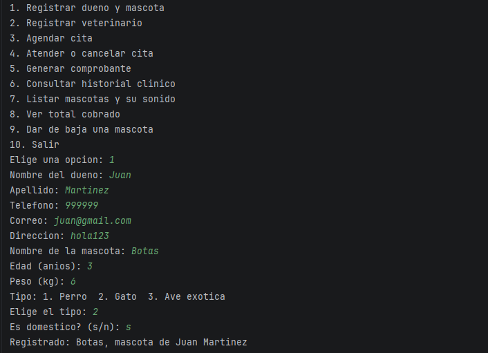

Después se registra a **Panfilo**, un perro de raza Corgi, eligiendo un dueño ya registrado (`s`) en lugar de capturar uno nuevo.

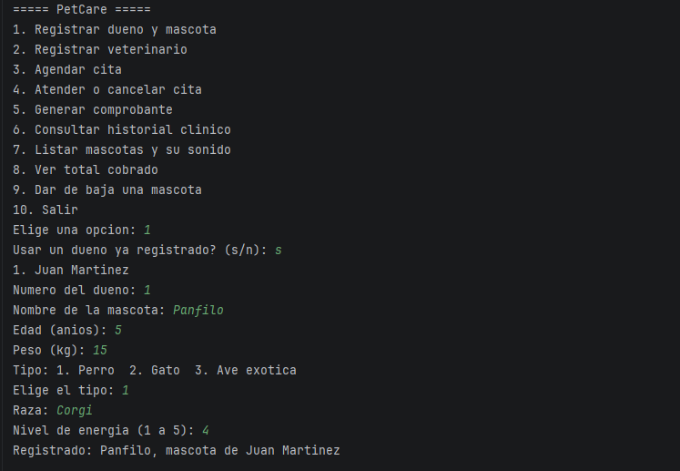

Por último se registra a una dueña nueva, María Pérez, con su ave exótica **Manuelito** (se pide la longitud de alas).

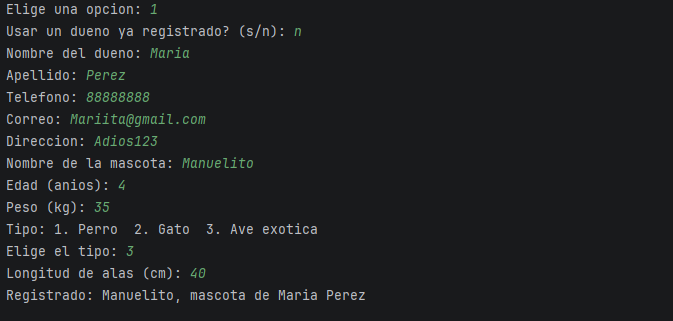

### 2. Registrar veterinarios

Se registran dos veterinarios: Manuel Gonzales (cirujano) y Pedro Torres (cardiología).

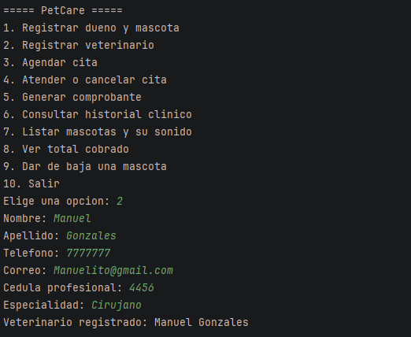

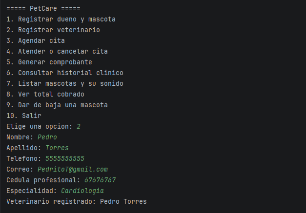

### 3. Agendar citas y ver sus costos

**Consulta general.** Aquí también se ve la validación de entradas: la primera fecha se escribe con un formato incorrecto, el programa avisa y vuelve a preguntar sin cerrarse.

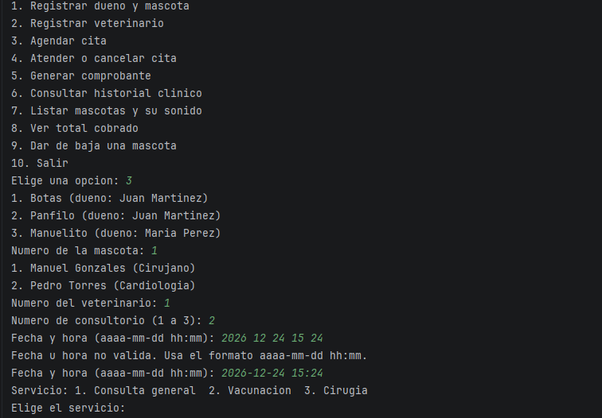

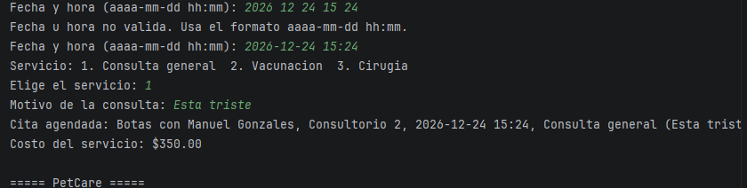

**Vacunación.** El costo total ($500.00) suma la aplicación y el costo de la vacuna capturado ($400).

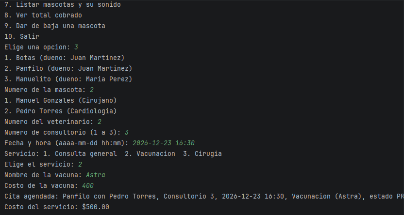

**Cirugía.** El costo se calcula con las horas de quirófano y el factor de complejidad (media, 3 horas: $6750.00).

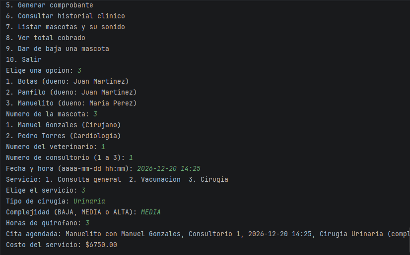

### 4. Atender citas

Se atienden la consulta de Botas ($350.00) y la vacunación de Panfilo ($500.00). Las citas se buscan por el nombre de la mascota.

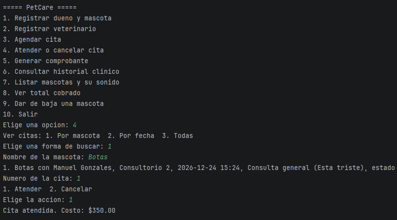

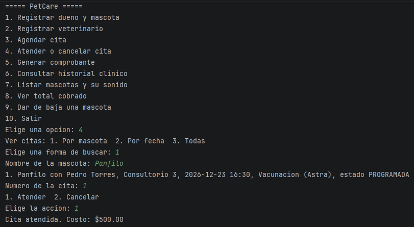

### 5. Listar las mascotas con su sonido (polimorfismo)

Cada mascota responde con el sonido propio de su clase al llamar a `hacerSonido()`.

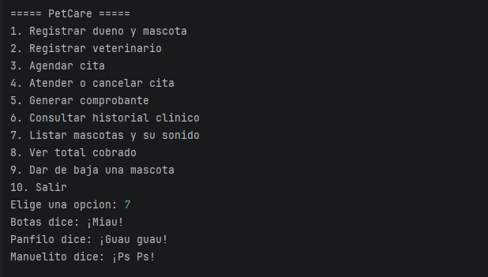

### 6. Total cobrado

Los cobros se agrupan por veterinario y por mascota. Solo cuentan las citas atendidas, por eso Manuelito aparece con $0.00: su cirugía sigue programada.

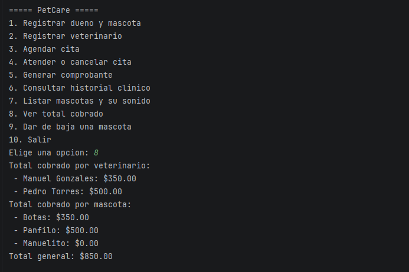

### 7. Historial clínico

El historial de Botas muestra la consulta que se atendió, con fecha, servicio, veterinario y costo.

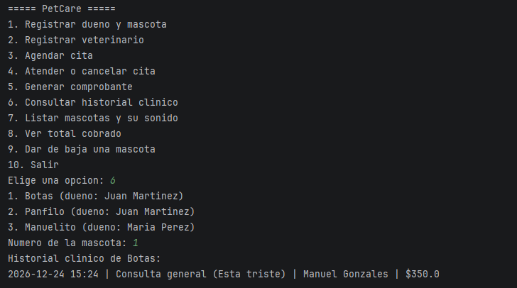

## Reglas de negocio

| Regla | Dónde se valida |
| --- | --- |
| El peso y la edad de una mascota no pueden ser cero ni negativos. | `Mascota.setEdad` (línea 57) y `Mascota.setPeso` (línea 72) lanzan `IllegalArgumentException`. El constructor usa esos setters, por lo que también se valida al crear la mascota. |
| Un veterinario no puede tener dos citas a la misma hora. | `Clinica.validarDisponibilidad` (línea 135), llamado desde `agendarCita`. Ignora las citas canceladas. |
| Una cita cancelada no puede marcarse como atendida. | `Cita.atender` (línea 52). Además, una cita ya atendida no se puede atender de nuevo ni cancelar. |
| Un consultorio no puede usarse en dos citas al mismo tiempo. | `Clinica.validarDisponibilidad` (línea 143). |
| Los costos nunca pueden ser negativos. | `Vacunacion` (línea 24), `Cirugia` (línea 35, horas mayores que cero) y `Comprobante` (línea 26). La consulta general usa una tarifa fija positiva. |
| Todo cobro se consulta por mascota y por veterinario. | `Clinica.totalCobradoPorMascota` (línea 223), `Clinica.totalCobradoPorVeterinario` (línea 207) y la opción 8 del menú (`Main.mostrarTotales`). |
| Solo se cobra una cita atendida. | `Comprobante` (constructor): rechaza citas que no estén atendidas. |
| Entradas incorrectas no cierran el programa. | `LectorConsola` repite la pregunta si el dato está vacío o no tiene el formato esperado (`NumberFormatException` y `DateTimeParseException`); `Main.iniciar` captura `IllegalArgumentException` y muestra el mensaje. |

## Reflexión


**¿Qué aprendiste en este proyecto?**

* **Programación Orientada a Objetos (POO):** Aprendí a aplicar herencia y polimorfismo al gestionar diferentes tipos de mascotas (perros, gatos, aves) con atributos específicos y comportamientos únicos, como la emisión de sus respectivos sonidos.
* **Gestión de datos en memoria:** Comprendí cómo vincular y estructurar múltiples entidades relacionales, asociando correctamente a los dueños con sus mascotas, y estas a su vez con veterinarios, consultorios y servicios médicos.
* **Validación y estados:** Implementé validaciones estrictas para las entradas del usuario (como el formato de fecha y hora) y aprendí a manejar la transición de estados de los objetos, como pasar una cita de programada a atendida para generar un cobro.

**¿Qué fue lo más difícil?**

* **Lógica de cálculos dinámicos:** Diseñar la estructura adecuada para recorrer el historial de atenciones y calcular con precisión los reportes financieros, desglosando los ingresos totales tanto por cada veterinario como por cada mascota.
* **Flujo de navegación en consola:** Mantener un menú interactivo robusto que permita flujos de varios pasos (buscar una cita, seleccionarla y cambiar su estado) sin que la ejecución del programa se interrumpa o pierda el contexto de los datos ingresados.

**¿Qué mejorarías si tuvieras más tiempo?**

* **Interfaz de Usuario (UI):** Migraría el proyecto de la línea de comandos a una Interfaz Gráfica (GUI) para hacer el sistema más intuitivo y visualmente agradable para el usuario final.


**Uso de la IA**

Principalmente, utilicé la IA como herramienta de apoyo para investigar conceptos que me resultaban confusos, como el funcionamiento de las ramas. Además, me sirvió para recibir orientación en la creación de diagramas UML, revisar y corregir errores complejos en el código, mejorar el formato del archivo README y validar el análisis de las clases. Finalmente, recurrí a ella para resolver dudas generales sobre el uso de herramientas de control de versiones como Git y GitHub.
## Autor

Bryan De Jesus Cobaxin Miss 

Universidad Veracruzana · Licenciatura en Ingeniería de Software · EE. Diseño y Programación Orientada a Objetos.
