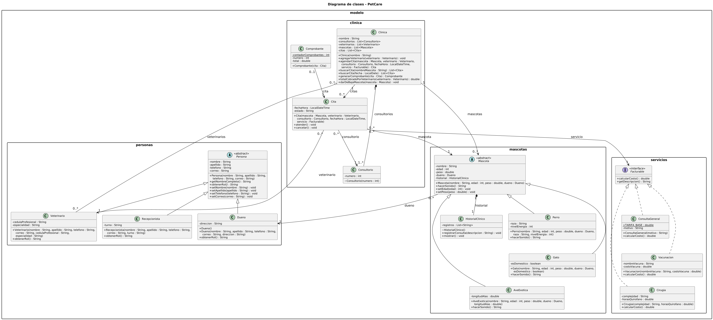

# Modelo de análisis: PetCare

## 1. Sustantivos y verbos del caso de estudio

**Clases o atributos**: persona, dueño, veterinario,
recepcionista, mascota, perro, gato, ave exótica, historial clínico, clínica, consultorio,
cita, servicio, consulta general, vacunación, cirugía, comprobante, nombre, apellido,
teléfono, correo, dirección, cédula, especialidad, turno, edad, peso, raza, nivel de
energía, longitud de alas, fecha y hora, costo, total.

**Verbos** (candidatos a métodos): registrar, agendar, atender, cancelar, calcular costo,
generar comprobante, consultar historial, emitir sonido, dar de baja, asignar veterinario a
la clínica, listar.

## 2. Tabla de clases y objetos

| Clase candidata | Tipo | Atributos principales | Responsabilidades (métodos) | Justificación |
|---|---|---|---|---|
| `Persona` | Abstracta | `nombre`, `apellido`, `telefono`, `correo` (String) | `getNombreCompleto()`, `obtenerRol()` (abstracto), setters con validación | Reúne los datos comunes de dueño, veterinario y recepcionista. Es abstracta porque no existe una "persona" genérica en la clínica. |
| `Dueno` | Concreta | `direccion: String` | `Dueno()` por defecto, `Dueno(todos los datos)`, `obtenerRol()` | Persona dueña de las mascotas. |
| `Veterinario` | Concreta | `cedulaProfesional`, `especialidad` (String) | constructor con `super(...)`, `obtenerRol()` | Atiende las citas. Existe aunque la clínica cierre, por eso la clínica lo recibe ya creado. |
| `Recepcionista` | Concreta | `turno: String` | constructor con `super(...)`, `obtenerRol()` | Completa la jerarquía de `Persona`. |
| `Mascota` | Abstracta | `nombre`, `edad: int`, `peso: double`, `dueno: Dueno`, `historial: HistorialClinico` | `hacerSonido()` (abstracto), `setEdad(int)` y `setPeso(double)` (validan > 0) | Reúne lo común a todos los animales. Crea su propio historial al construirse. |
| `Perro` | Concreta | `raza: String`, `nivelEnergia: int` | constructor con `super(...)`, `hacerSonido()` | Primer tipo de mascota. |
| `Gato` | Concreta | `esDomestico: boolean` | constructor con `super(...)`, `hacerSonido()` | Segundo tipo de mascota. |
| `AveExotica` | Concreta | `longitudAlas: double` | constructor con `super(...)`, `hacerSonido()` | Tercer tipo de mascota. |
| `HistorialClinico` | Concreta | `registros: List<String>` | `registrarConsulta(String)`, `mostrar()` | No tiene sentido sin su mascota: la mascota lo crea y desaparece con ella. |
| `Facturable` | Interfaz | (ninguno) | `calcularCosto(): double`, `getDescripcion(): String` | Contrato de todo lo que se cobra; permite sumar costos con polimorfismo, sin `instanceof`. |
| `ConsultaGeneral` | Concreta (implementa `Facturable`) | `TARIFA_BASE` (static final), `motivo` | `calcularCosto()` devuelve la tarifa base | Servicio de costo fijo. |
| `Vacunacion` | Concreta (implementa `Facturable`) | `nombreVacuna`, `costoVacuna` | `calcularCosto()` suma el costo de la vacuna a la aplicación | Servicio cuyo costo incluye la vacuna. |
| `Cirugia` | Concreta (implementa `Facturable`) | `complejidad`, `horasQuirofano` | `calcularCosto()` según complejidad y horas | Servicio con el cálculo más complejo. |
| `Cita` | Concreta | `mascota`, `veterinario`, `consultorio`, `fechaHora`, `servicio: Facturable`, `estado` | `atender()`, `cancelar()` | Relaciona objetos independientes. Concentra el cambio de estado y la regla de que una cita cancelada no se atiende. |
| `Comprobante` | Concreta | `contadorComprobantes` (static), `numero`, `cita`, `total` | `Comprobante(Cita)` | Registro del cobro de una cita atendida. El contador estático da el número consecutivo y valida que el total no sea negativo. |
| `Consultorio` | Concreta | `numero: int` | `Consultorio(int)` (acceso de paquete) | Pertenece a la clínica: solo ella lo crea y desaparece con ella. |
| `Clinica` | Concreta | `nombre`, `consultorios`, `veterinarios`, `mascotas`, `citas` | `agregarVeterinario`, `agendarCita` (reglas de horario y consultorio), `buscarCita(String)` y `buscarCita(LocalDate)`, `generarComprobante`, `totalCobradoPorVeterinario`, `darDeBajaMascota` | Punto de entrada del dominio: coordina las colecciones y las reglas que involucran a varios objetos. |

### Clases de apoyo

`Main` (menú de consola), `LectorConsola` (lectura y validación de entradas) y las
enumeraciones `EstadoCita`, `Complejidad` y `Turno` existen en el código como apoyo, pero se
omiten del diagrama para mantenerlo legible. En el diagrama sus valores se muestran como
atributos de tipo `String`.

## 3. Objetos de ejemplo

| Objeto | Clase | Valores |
|---|---|---|
| `ana` | `Dueno` | nombre = "Ana", apellido = "Ramirez", telefono = "9991234567", correo = "ana.ramirez@correo.com", direccion = "Calle 60 #123, Merida" |
| `rocky` | `Perro` | nombre = "Rocky", edad = 4, peso = 18.5, dueno = `ana`, raza = "Labrador", nivelEnergia = 4 (`hacerSonido()` devuelve "Guau") |
| `cita1` | `Cita` | mascota = `rocky`, veterinario = "Dr. Luis Lopez", consultorio = nº 1, fechaHora = 2026-11-03 10:00, servicio = `ConsultaGeneral` (motivo = "Revision anual"), estado = PROGRAMADA |

## 4. Clases descartadas

| Candidata | Por qué se descartó |
|---|---|
| `Sonido` | Es solo el texto que devuelve `hacerSonido()`; no tiene estado ni comportamiento propio. |
| `Vacuna` | Solo hacen falta su nombre y su costo, que ya son atributos de `Vacunacion`. |
| `RegistroConsulta` | Basta guardar cada consulta como texto en el historial; una clase aparte no aporta comportamiento. |

# Justificación de las relaciones

Para elegir el tipo de cada relación pensé en el ciclo de vida: **¿qué pasa con una de las partes si la otra se elimina?**

- **Composición:** la parte no existe sin el todo y desaparece con él.
- **Agregación:** la parte existe por sí misma y sigue existiendo si el todo se elimina.
- **Asociación:** son objetos independientes que solo se conocen entre sí.

## Composición

**Mascota < HistorialClinico (1 a 1, rol `historial`).** El historial no tiene sentido sin su mascota: la mascota lo crea en su constructor y, si se elimina del sistema, su historial desaparece con ella. No es agregación porque el historial no puede existir ni compartirse por separado.

**Clinica < Consultorio (1 a 1..\*, rol `consultorios`).** Los consultorios pertenecen a la clínica, solo ella los crea y desaparecen con ella; un consultorio no puede pasar a otra clínica. No es agregación porque no tiene vida propia fuera de la clínica.

## Agregación

**Clinica < Veterinario (0..\* a 0..\*, rol `veterinarios`).** El veterinario existe aunque la clínica cierre y puede trabajar en otra, por eso la clínica lo recibe ya creado y no lo crea ella. Si la clínica se elimina, el veterinario sigue existiendo, así que no es composición.

## Asociación

**Mascota > Dueno (0..\* a 1, rol `dueno`).** Una mascota siempre tiene un dueño, pero el dueño es una persona independiente: si la mascota se da de baja, el dueño sigue existiendo. Ninguno es parte del otro, por eso es asociación.

**Clinica > Mascota (1 a 0..\*, rol `mascotas`).** La clínica solo guarda a las mascotas registradas para buscarlas y darlas de baja, pero no las crea ni es su dueña. Las mascotas son objetos independientes que se registran y se retiran del sistema, por eso no es agregación ni composición.

**Clinica > Cita (1 a 0..\*, rol `citas`).** La clínica lleva la agenda de citas para consultarlas y validar las reglas de horario y consultorio. La cita es un acuerdo entre objetos que ya existen (mascota, veterinario y consultorio), no una parte de la clínica, por eso es asociación.

**Cita > Mascota (0..\* a 1, rol `mascota`).** Una cita solo hace referencia a la mascota que se atiende. Si la cita se cancela o se elimina, la mascota sigue existiendo, por eso no es composición.

**Cita > Veterinario (0..\* a 1, rol `veterinario`).** La cita referencia al veterinario que la atiende, pero este no depende de ella: un mismo veterinario puede tener muchas citas y, si una se elimina, él sigue existiendo.

**Cita > Consultorio (0..\* a 1, rol `consultorio`).** La cita solo usa un consultorio de la clínica para una fecha y hora. El consultorio pertenece a la clínica (composición) y no a la cita, así que desaparecer la cita no lo afecta.

**Cita > Facturable (0..\* a 1, rol `servicio`).** La cita guarda el servicio que se va a cobrar a través de la interfaz, sin depender de una clase concreta: puede ser consulta, vacunación o cirugía. El servicio solo calcula su costo y no tiene un ciclo de vida atado a la cita, por eso es asociación.

**Comprobante > Cita (0..1 a 1, rol `cita`).** El comprobante hace referencia a la cita atendida que cobra. La cita existe sin comprobante mientras está programada o cancelada, y si el comprobante se elimina la cita sigue existiendo, por eso no es composición.